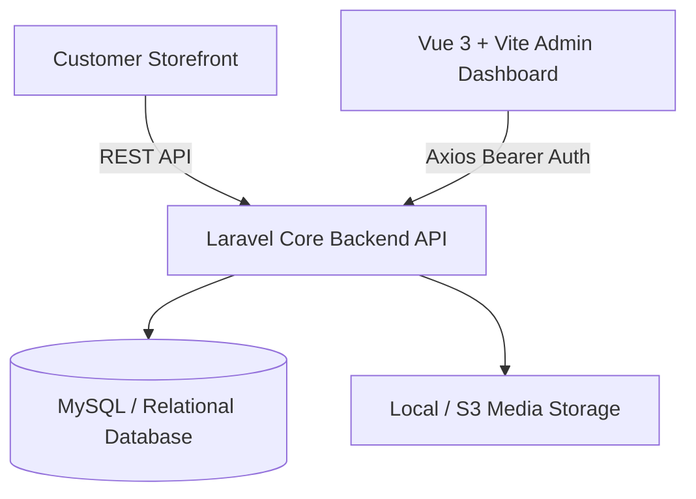

# 🛍️ Laravel & Vue 3 Enterprise E-Commerce Platform

[](https://laravel.com/)
[](https://vuejs.org/)
[](https://vitejs.dev/)
[](https://tailwindcss.com/)
[](https://router.vuejs.org/)
[](https://axios-http.com/)

> An end-to-end fullstack E-Commerce solution featuring a **Laravel RESTful API** backend and a dedicated, responsive **Vue 3 Single Page Application (SPA) Admin Backoffice** powered by **Vite** and **Tailwind CSS**.

---

## 🌟 Architectural Architecture



---

## 🚀 Key Features

### 🔧 Backend Core (Laravel)
- **Customer & Address Management:** Multi-address support per customer with default shipping/billing destination rules.
- **Cart & Order Processing:** Real-time stock validation, persistent shopping cart items, order breakdown, and payment status lifecycle.
- **Product Catalog:** Category hierarchies, rich descriptions, image galleries, and pricing.
- **Token Authentication:** Secure API authentication via Laravel Sanctum with Bearer token headers.

### 💻 Admin Backoffice (`admin/`) — Vue 3 & Vite
- **Modern Composition API:** Written in modular Vue 3 with scalable component design.
- **Centralized State Management:** Reactive store handling authentication tokens, global loading states, and API error toasts.
- **Client-Side Routing:** Vue Router 4 with navigation guards for protected admin routes.
- **Tailwind UI Components:** Clean, high-contrast dashboard layout with data tables, pagination, and modals.

---

## 📂 Repository Layout

```text
laravel_vue_ecommerce/
├── admin/                      # Vue 3 + Vite Single Page Application
│   ├── src/
│   │   ├── components/         # Reusable UI elements (Navbar, Sidebar, Modals)
│   │   ├── views/              # Admin view pages (Products, Orders, Customers)
│   │   ├── router/             # Vue Router route map & route guards
│   │   ├── store/              # Centralized reactive state
│   │   └── axios.js            # Pre-configured HTTP client with interceptors
│   ├── package.json
│   └── vite.config.js
├── app/                        # Laravel Application Layer
│   ├── Http/Controllers/       # API endpoints (Auth, Cart, Order, Product)
│   └── Models/                 # Customer, Order, OrderItem, Product, CartItem
├── database/migrations/        # Relational schema migrations
└── routes/
    └── api.php                 # Versioned REST API endpoints
```

---

## 🛠️ Getting Started

### 1. Backend Setup
```bash
composer install
cp .env.example .env
php artisan key:generate
php artisan migrate --seed
php artisan serve
```

### 2. Admin Panel Setup
```bash
cd admin
npm install
npm run dev
```

---

## 📄 License
This open-source project is licensed under the MIT License.
