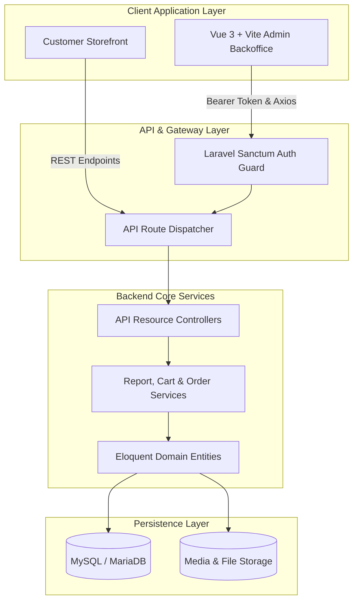

# 🛍️ Laravel & Vue 3 Enterprise E-Commerce Platform

[](https://laravel.com/)
[](https://vuejs.org/)
[](https://vitejs.dev/)
[](https://tailwindcss.com/)
[](https://www.chartjs.org/)
[](https://router.vuejs.org/)
[](LICENSE)

> A modern, production-grade fullstack E-Commerce platform featuring a **Laravel 11 RESTful API** backend and a high-performance **Vue 3 Single Page Application (SPA) Admin Backoffice** powered by **Vite 6**, **Tailwind CSS**, and **Chart.js**.

---

## 🏛️ System Architecture



---

## ✨ Key Modules & Capabilities

### 1. 📊 Interactive Executive Dashboard (`Dashboard.vue`)
- **Key Performance Indicators (KPIs):** Real-time metrics for total revenue, paid orders, active customers, and catalog items.
- **Dynamic Date-Range Filtering:** Instant recalculation for Today, Last 7 Days, Last 30 Days, and Custom Periods.
- **Visual Analytics:** Interactive Line, Bar, and Doughnut charts powered by **Chart.js 4** and **vue-chartjs 5**.
- **Recent Activity Feeds:** Live feeds for newest orders and newly registered customers.

### 2. 📦 Catalog & Product Management (`Products/`)
- **Data Table Engine:** Client-side and server-paginated data table with live search and multi-column sorting (`TableHeaderCell.vue`).
- **Product Modal with File Upload:** Reactive modal dialog for adding/editing products, handling image uploads with previews, pricing, and descriptions.
- **Action Menu:** Quick access to edit, delete, and duplicate catalog entries with optimistic state updates.

### 3. 📑 Order Fulfillment Lifecycle (`Orders/`)
- **Deterministic State Machine:** Tracking orders across `unpaid`, `paid`, `shipped`, `completed`, and `cancelled` statuses.
- **Detailed Order View:** Comprehensive breakdown of line items, billing/shipping addresses, payment transactions, and customer profile linkages.

### 4. 👥 Customer 360 & User Administration (`Customers/` & `Users/`)
- Multi-address customer profile management (Default billing vs. Default shipping).
- Admin staff management with password resets and granular account status control.

### 5. 📈 Advanced Reporting Suite (`Reports/`)
- **Orders Report:** Comprehensive daily/weekly order volume and revenue aggregates.
- **Customers Report:** Cohort acquisition trends and customer lifetime activity reports.

### 6. 🧩 Reusable Core Component Architecture (`components/core/`)
- `CustomInput.vue` — Unified form control supporting text, textarea, select, checkbox, and file inputs with validation error binding.
- `TableHeaderCell.vue` — Sortable table header supporting ascending/descending states.
- `Spinner.vue` — Lightweight SVG-based loading indicator.
- `Toast.vue` — Global alert notification banner driven by Vuex state.

---

## 🛠️ Tech Stack & Libraries

| Domain | Technology | Description |
|---|---|---|
| **Frontend Framework** | Vue 3.5 (Composition API) | High-performance reactive UI framework |
| **Build Tooling** | Vite 6.0 | Ultra-fast HMR and optimized production bundling |
| **Styling** | Tailwind CSS 3.4 | Utility-first CSS framework with `@tailwindcss/forms` |
| **Charts & Data Viz** | Chart.js 4 & vue-chartjs 5 | Responsive charting components |
| **UI Primitives** | Headless UI & Heroicons v2 | Accessible headless dropdowns, modals, and SVG icons |
| **Routing** | Vue Router 4 | History mode routing with navigation guards |
| **State Management** | Vuex 4 | Centralized store with module segregation |
| **Backend Framework** | Laravel 11.x (PHP 8.2+) | Modern PHP framework |
| **Authentication** | Laravel Sanctum | Token-based API security |

---

## 🚀 Getting Started

### Prerequisites
- Node.js `>= 18.x` (Tested on v22)
- PHP `>= 8.2`
- Composer `>= 2.0`
- MySQL `>= 8.0`

### 1. Admin SPA Setup
```bash
cd admin

# Install modern dependencies
npm install

# Start Vite development server (port 3000)
npm run dev

# Build for production
npm run build
```

### 2. Laravel Backend Setup
```bash
# Install PHP dependencies
composer install

# Environment configuration
cp .env.example .env
php artisan key:generate

# Database migration & seeding
php artisan migrate --seed

# Start backend server
php artisan serve
```

---

## 🔒 Security & Code Standards

- **Strict Bearer Token Guards:** All administrative routes are protected via Sanctum middleware.
- **Form Request Validation:** All mutations (Products, Orders, Customers) pass through dedicated `FormRequest` validation pipelines.
- **Resource Transforms:** Consistent JSON schema responses using Laravel API Resources.

---

## 👨‍💻 Author

**Navid Mirtorabi**  
- GitHub: [@namirma](https://github.com/namirma)  
- Email: [navidm632@gmail.com](mailto:navidm632@gmail.com)
