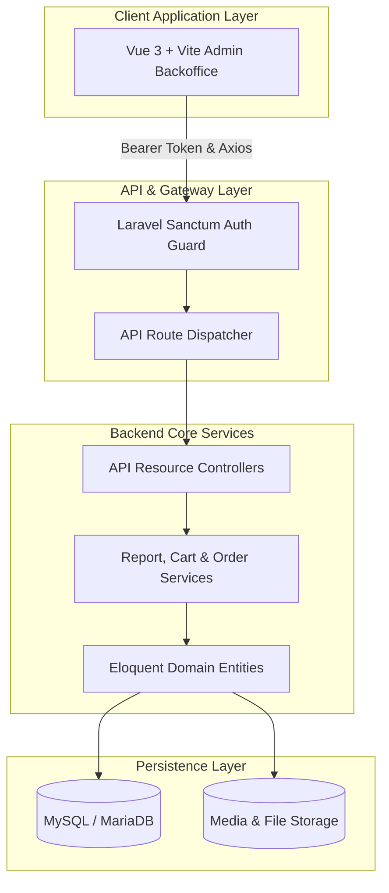

# 🛍️ Laravel & Vue 3 E-Commerce Admin

[](https://laravel.com/)
[](https://vuejs.org/)
[](https://vitejs.dev/)
[](https://tailwindcss.com/)
[](https://www.chartjs.org/)
[](https://router.vuejs.org/)
[](LICENSE)

> A small fullstack e-commerce platform: a **Laravel 11 REST API** and a
> **Vue 3 admin SPA**. This is a personal, handmade test project — there is
> no customer storefront in this repository yet, only the API and the admin
> backoffice.

---

## 🏛️ System Architecture



---

## ✨ What the admin covers

### 1. 📊 Dashboard (`Dashboard.vue`)
- **KPIs from the API:** total income, paid orders, active customers and
  active products, for the selected period
  (`/api/dashboard/customers-count`, `products-count`, `orders-count`,
  `income-amount`).
- **Orders by country** from `/api/dashboard/orders-by-country`, with the
  top 3 markets computed from that data.
- **Latest customers and latest orders** from the matching API endpoints.
- **Revenue trend line chart:** there is **no monthly-revenue API endpoint
  yet**, so this chart is empty in live mode and shows sample data only in
  demo mode (see below). It is labelled as such in the UI.

### 2. 📦 Catalog & Product Management (`Products/`)
- Server-paginated data table with live search and multi-column sorting
  (`TableHeaderCell.vue`).
- Product modal for adding/editing products, with image upload previews,
  pricing and descriptions.
- Edit, delete and duplicate actions on catalog entries.

### 3. 📑 Order Management (`Orders/`)
- Orders across `unpaid`, `paid`, `shipped`, `completed` and `cancelled`
  statuses, with a detailed order view (line items, billing/shipping
  addresses, payment transactions and customer linkage).

### 4. 👥 Customers & Users (`Customers/` & `Users/`)
- Customer profiles with billing and shipping addresses.
- Admin staff management with password resets and account status control.

### 5. 📈 Reports (`Reports/`)
- **Orders report** and **customers report**, both served by
  `/api/report/orders` and `/api/report/customers` as per-day counts.
  In live mode a failed report request leaves the chart empty; sample
  series are shown only in demo mode.

### 6. 🧩 Reusable Core Components (`components/core/`)
- `CustomInput.vue` — form control supporting text, textarea, select,
  checkbox and file inputs with validation error binding.
- `TableHeaderCell.vue` — sortable table header.
- `Spinner.vue` — lightweight SVG loading indicator.
- `Toast.vue` — alert banner driven by Vuex state.
- `Charts/Line.vue`, `Charts/Bar.vue`, `Charts/Doughnut.vue` — Chart.js
  wrappers via vue-chartjs.

---

## 🛠️ Tech Stack & Libraries

Versions below are the ones resolved in `admin/package-lock.json`
(and `composer.lock` for the backend) at the last update.

| Domain | Technology | Description |
|---|---|---|
| **Frontend Framework** | Vue 3.5 (Composition API) | Reactive UI framework |
| **Build Tooling** | Vite 8 | Production bundling (Rolldown-based) |
| **Styling** | Tailwind CSS 4 | Utility-first CSS framework with `@tailwindcss/forms` |
| **Charts & Data Viz** | Chart.js 4 & vue-chartjs 5 | Charting components |
| **UI Primitives** | Headless UI & Heroicons v2 | Accessible dropdowns, modals and SVG icons |
| **Routing** | Vue Router 5 | History mode routing with navigation guards |
| **State Management** | Vuex 4 | Centralized store |
| **Backend Framework** | Laravel 11.37 (PHP 8.2+) | PHP framework |
| **Authentication** | Laravel Sanctum 4 | Token-based API security |

---

## 🚀 Getting Started

### Prerequisites
- Node.js `>= 18.x` (tested on Node 24)
- PHP `>= 8.2`
- Composer `>= 2.0`
- MySQL `>= 8.0`

### 1. Admin SPA Setup
```bash
cd admin

# Install dependencies
npm install

# Start Vite development server (port 3000)
npm run dev

# Build for production
npm run build
```

The admin calls the API at `VITE_API_BASE_URL` (see
`admin/.env.example`; default `http://localhost:8000`).

### Demo mode (preview without an API)

Demo mode is **off by default**. When it is off, a failed API call is a real
error and the lists start empty — no sample data is injected. To preview the
admin with sample data, run it with:

```bash
cd admin
VITE_DEMO_MODE=true npm run dev
```

In demo mode a banner says "Demo mode — showing sample data", the login page
shows a demo sign-in button, and creates/updates/deletes only change the
local sample rows. Never enable demo mode against a real store.

### 2. Laravel Backend Setup
```bash
# Install PHP dependencies
composer install

# Environment configuration
cp .env.example .env
php artisan key:generate

# Database migration & seeding
php artisan migrate --seed

# Start backend server
php artisan serve
```

The root `/` route is only a small landing page (see
`resources/views/welcome.blade.php`); it states that there is no customer
storefront yet.

---

## 🔒 Security & Code Standards

- **Sanctum guards:** administrative API routes are protected via Sanctum
  middleware (see `routes/api.php`).
- **Form Request Validation:** mutations (Products, Orders, Customers) pass
  through dedicated `FormRequest` validation pipelines.
- **Resource Transforms:** consistent JSON schema responses using Laravel
  API Resources.

## ⚠️ Known limits (honest, not yet done)

- **Laravel 12 upgrade:** not attempted — it needs a PHP/Composer runtime
  and a test run, neither of which was available here. The backend stays on
  Laravel 11.37.
- **Monthly revenue chart:** no API endpoint provides monthly revenue yet,
  so the dashboard line chart is empty in live mode (see above).
- **Unrouted web controllers:** the classic web controllers under
  `app/Http/Controllers/` (Breeze auth, cart, checkout, profile) have no
  web routes — `routes/web.php` only serves the landing page — and were
  left in place rather than deleted untested. The API controllers under
  `app/Http/Controllers/Api/` and the `App\Models\Api\*` subclasses they
  use (route key `id` instead of `slug`) are the live ones.
- **Tests:** only the Laravel example tests exist; there is no admin
  (Vitest) test suite yet.
- **Major frontend upgrades** (Vite 8, Tailwind 4, Vue Router 5) were
  verified by production builds in normal and demo mode only; a visual
  check in a browser is still recommended before release, since a build
  cannot prove visual parity.

---

## 👨‍💻 Author

**Navid Mirtorabi**
- GitHub: [@namirma](https://github.com/namirma)
- Email: [navidm632@gmail.com](mailto:navidm632@gmail.com)
